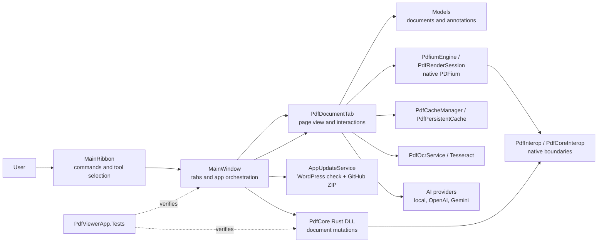
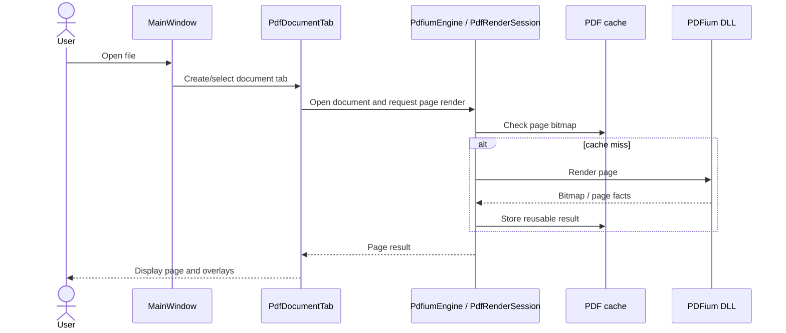
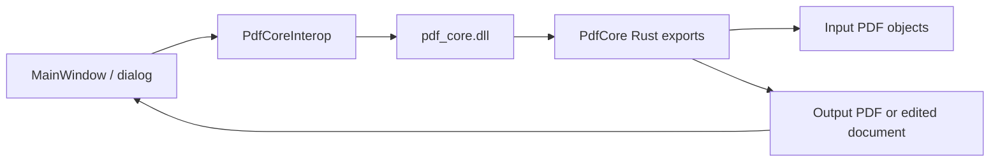

# PDF Pro project roadmap and architecture

> Purpose: give AI agents a reliable, source-linked map of the desktop PDF application. This is an engineering roadmap, not a dated product promise. Proposed priorities below must be re-evaluated against current code, user reports, and tests before implementation.

## 1. Project at a glance

PDF Pro is a Windows desktop PDF application. The main client is a WPF/.NET 8 application. PDFium renders and reads PDF pages through native interop. A Rust `cdylib` (`pdf_core.dll`) performs a subset of document mutations. The C# layer owns the application UI, document tabs, annotation interaction, and most application services. The repository also contains release/update scripts and WordPress/site projects; those are separate deployable surfaces.

Current version source: [`VERSION.txt`](../VERSION.txt). Re-check it during work.



## 2. Repository map

| Path | Role | Notes |
|---|---|---|
| `src/PdfViewerApp/` | WPF desktop client | UI, document tab, models, services, native PDFium DLLs and resources. Main project: [`PdfViewerApp.csproj`](../src/PdfViewerApp/PdfViewerApp.csproj). |
| `src/PdfCore/` | Rust native library | Builds the `pdf_core` `cdylib`; current Rust modules include [`lib.rs`](../src/PdfCore/src/lib.rs) and [`text_editor.rs`](../src/PdfCore/src/text_editor.rs). |
| `src/PdfViewerApp.Tests/` | .NET tests | Tests for cache, licensing, and security currently live here. See [`project file`](../src/PdfViewerApp.Tests/PdfViewerApp.Tests.csproj). |
| `app-upgrade/` | Shared update client | Update support packaged with the app. Read its [README](../app-upgrade/UpdateClient/README.md) before changing update installation behavior. |
| `tools/` | Build, release, and maintenance scripts | `release.ps1` drives the authorized version/build/commit/tag/push/release flow. Review `-ChangedPaths` carefully. |
| `.github/workflows/` | CI/CD | [`release.yml`](../.github/workflows/release.yml) creates the release, verifies the uploaded assets, then publishes update metadata. |
| `docs/` | Feature and process documentation | Some older notes may no longer match source. Confirm paths and current code. |
| `wp-pdfpro-licensing/` | WordPress licensing/update server plugin | Separate PHP project and deployment surface; not part of the WPF build. |
| `theme/`, `vn-privacy-form-builder/`, other WordPress files | Adjacent site projects | Do not include them in desktop app changes without a task that names them. |
| `graphify-out/` | Generated source relationship graph | Derived navigation artifact. Rebuild/update after meaningful source or docs changes. Do not treat inferred edges as proof. |

## 3. Component map

### 3.1 Application shell and command flow

- [`MainWindow.xaml`](../src/PdfViewerApp/UI/Windows/MainWindow.xaml) defines the application shell and ribbon host.
- [`MainWindow.xaml.cs`](../src/PdfViewerApp/UI/Windows/MainWindow.xaml.cs) owns app-level orchestration: active tabs, command routing, open/merge flows, tool synchronization, activation checks, keyboard handling, and service entry points.
- [`MainRibbon.xaml`](../src/PdfViewerApp/UI/Controls/MainRibbon.xaml) defines ribbon controls; [`MainRibbon.xaml.cs`](../src/PdfViewerApp/UI/Controls/MainRibbon.xaml.cs) raises events for the window to handle.
- [`WelcomeDashboard`](../src/PdfViewerApp/UI/Controls/WelcomeDashboard.xaml.cs) is the document-free start surface.
- Dialogs are under [`UI/Dialogs`](../src/PdfViewerApp/UI/Dialogs/). Many contain both XAML and code-behind; keep markup and handler changes aligned.

Typical command path: ribbon button → `MainRibbon` event → handler in `MainWindow` → active `PdfDocumentTab` or service → state/event refresh back to the shell.

### 3.2 Document tab, render, and page interaction

- [`PdfDocumentTab.xaml`](../src/PdfViewerApp/UI/Controls/PdfDocumentTab.xaml) defines the page canvas, navigation/sidebar, and document controls.
- [`PdfDocumentTab.xaml.cs`](../src/PdfViewerApp/UI/Controls/PdfDocumentTab.xaml.cs) is the main interaction coordinator. It handles many pointer states and remains a high-coupling area even though behavior is split into `PdfDocumentTab.*.cs` partial files.
- Related partials: rendering, annotation, OCR, snapshot, text selection/native text editing, zoom, sidebar, and document details.
- [`PdfiumEngine.cs`](../src/PdfViewerApp/Core/PdfiumEngine.cs) wraps PDFium operations. [`PdfRenderSession.cs`](../src/PdfViewerApp/Core/PdfRenderSession.cs) manages a render/document session; [`PdfInterop.cs`](../src/PdfViewerApp/Core/PdfInterop.cs) contains native PDFium declarations.
- [`PdfCacheManager.cs`](../src/PdfViewerApp/Services/Cache/PdfCacheManager.cs) and [`PdfPersistentCache.cs`](../src/PdfViewerApp/Services/Cache/PdfPersistentCache.cs) provide render/cache behavior. Check invalidation and document-close paths when changing rendering.
- [`DocumentNavigationStateService.cs`](../src/PdfViewerApp/Core/DocumentNavigationStateService.cs) holds navigation-related state behavior.

### 3.3 Annotation and text editing

- Shared annotation types derive from [`PdfAnnotation`](../src/PdfViewerApp/Models/Annotations/PdfAnnotation.cs) under `Models/Annotations/` (text box, sticky note, callout, highlight, ink, shape, measurement, signature, snapshot selection).
- Pointer creation/edit/selection is coordinated by `PdfDocumentTab`; rendering and page-relative coordinates must stay consistent across zoom, page resize, export, and print.
- [`PdfDocumentPaginator.cs`](../src/PdfViewerApp/Core/PdfDocumentPaginator.cs) draws page output for print/export. Verify whether a feature uses PDFium-native annotation output or WPF overlays before changing persistence behavior.
- Native text edits go through [`PdfNativeTextEditor.cs`](../src/PdfViewerApp/Core/PdfNativeTextEditor.cs), its session partial, and the Rust text editor bridge. Overlay text annotations are a different data path from editing existing PDF text.
- When tracing an annotation bug, follow: ribbon tool selection → `ActiveTool` sync → canvas mouse handlers → editor/annotation model → redraw → save/export/print.

### 3.4 Rust core and native boundaries

- [`Cargo.toml`](../src/PdfCore/Cargo.toml) names the crate `pdf_core` and builds a `cdylib`.
- Rust exports are consumed by the WPF client through [`PdfCoreInterop.cs`](../src/PdfViewerApp/Services/PdfCoreInterop.cs) and/or [`PdfInterop.cs`](../src/PdfViewerApp/Core/PdfInterop.cs), depending on the operation. Confirm the exact call before modifying an export signature.
- [`lib.rs`](../src/PdfCore/src/lib.rs) implements native PDF operations. [`text_editor.rs`](../src/PdfCore/src/text_editor.rs) handles native PDF text editing.
- Keep C ABI names, argument types, buffer ownership, error conventions, target architecture, and copied output DLLs synchronized. Build both Rust and WPF after native signature changes.

### 3.5 Services, AI, OCR, and external systems

- `Services/` groups activation/licensing, HTTP helpers, cache, diagnostics, recent files, explorer integration, performance logging, and update behavior.
- [`AppUpdateService.cs`](../src/PdfViewerApp/Services/Update/AppUpdateService.cs) and [`AppUpdateModels.cs`](../src/PdfViewerApp/Services/Update/AppUpdateModels.cs) define client update checking; [`UpdateInstallerScript.cs`](../src/PdfViewerApp/Services/Update/UpdateInstallerScript.cs) embeds/coordinates update installation.
- [`PdfViewerApp.Ai/`](../src/PdfViewerApp/PdfViewerApp.Ai/) contains provider abstraction and local/OpenAI/Gemini snapshot providers. [`AiSnapshotRouter.cs`](../src/PdfViewerApp/PdfViewerApp.Ai/AiSnapshotRouter.cs) selects a provider; [`AiPanelControl.xaml.cs`](../src/PdfViewerApp/UI/Controls/AiPanelControl.xaml.cs) owns the UI surface.
- [`PdfOcrService.cs`](../src/PdfViewerApp/Core/PdfOcrService.cs) connects OCR behavior to the app. OCR language data and third-party notices are assets in `src/PdfViewerApp/tessdata/`.
- The update client fetches metadata from the WordPress update API and packages from the GitHub Release ZIP. Do not replace the ZIP URL with an EXE or GitHub source archive.

## 4. Important user workflows

### Open and render a PDF



### Modify document pages



Use this path for Rust-backed operations such as page and document mutation. Not every feature uses Rust: rendering and a number of page-level interactions go through PDFium/C#.

### Build and release

```mermaid
flowchart LR
    Source[master + version files] --> Tag[vX.Y.Z tag]
    Tag --> CI[GitHub Actions release.yml]
    CI --> Build[Rust DLL + WPF publish]
    Build --> Packages[Installer EXE + update ZIP]
    Packages --> Metadata[Manifest + SHA256SUMS]
    Metadata --> Draft[Upload draft release]
    Draft --> Verify[Download and verify four assets]
    Verify --> Public[Publish GitHub Release]
    Public --> WP[Notify WordPress update API]
    WP --> Check[GET update-check + actual ZIP hash check]
```



The release procedure is a mandatory safety gate. See [AGENTS.md](../AGENTS.md), [DEVELOPMENT_RULES.md](../DEVELOPMENT_RULES.md), [`tools/release.ps1`](../tools/release.ps1), and [`release.yml`](../.github/workflows/release.yml). Local package hashes are not a substitute for the CI-produced downloadable ZIP hash.

## 5. Feature-to-source index

| Feature area | UI / entry point | Core implementation | Data / integration |
|---|---|---|---|
| Open, tabs, keyboard, navigation | `UI/Windows/MainWindow.xaml.cs` | `Core/DocumentNavigationStateService.cs`; `UI/Controls/PdfDocumentTab.*.cs` | `Models/PdfFileItem.cs` |
| Render, zoom, pan, cache | `UI/Controls/PdfDocumentTab.Rendering.cs`, `.Zoom.cs` | `Core/PdfiumEngine.cs`; `Core/PdfRenderSession.cs` | `Services/Cache/` |
| Select/copy/highlight text | `UI/Controls/PdfDocumentTab.TextSelection.cs` | `Core/PdfiumEngine.cs`; `Core/PdfOcrService.cs` as applicable | `Models/Annotations/PdfHighlightAnnotation.cs` |
| Edit existing PDF text | `UI/Controls/PdfDocumentTab.NativeTextEditing.cs` | `Core/PdfNativeTextEditor*.cs`; `src/PdfCore/src/text_editor.rs` | `Services/PdfCoreInterop.cs` |
| Annotations and drawing tools | Ribbon; `UI/Controls/PdfDocumentTab.xaml.cs` | `UI/Controls/PdfDocumentTab.Annotations.cs` | `Models/Annotations/` |
| OCR | `UI/Dialogs/OcrOptionsDialog.xaml.cs`, `.Ocr.cs` | `Core/PdfOcrService.cs` | `tessdata/` assets |
| AI snapshot / explain | `UI/Controls/AiPanelControl.xaml.cs`; `PdfDocumentTab.Snapshot.cs` | `PdfViewerApp.Ai/` | local/OpenAI/Gemini providers; `AiSettings` |
| Merge and page management | `UI/Dialogs/MergeDialog.xaml.cs`; `PageOrganizerWindow.xaml.cs` | `Services/PdfCoreInterop.cs`; Rust `lib.rs` | temp/output PDFs; merge workflow docs |
| Print | `UI/Dialogs/PrintOptionsDialog.*`; `PrintProgressDialog.xaml.cs` | `Core/NativePdfPrinter.cs`; `PdfDirectPrintJob.cs`; `PrintWorker.cs`; `PdfDocumentPaginator.cs` | printer profile and print progress models |
| Secure / compare / compress / extract | `UI/Dialogs/PdfSecurityDialog.xaml.cs`; related dialogs | `Core/PdfiumEngine.cs`, Rust interop where called | dialog-specific models/services |
| Activation and license | `UI/Dialogs/ActivationDialog.xaml.cs`; `MainWindow` gate | `Services/ActivationLicense.cs` | `Models/ActivationRecord.cs`, `ActivationState.cs` |
| In-app update | `UI/Dialogs/UpdateDialog.xaml.cs`; app startup/check entry | `Services/Update/` and `app-upgrade/` | WordPress update-check; GitHub ZIP |
| Explorer context menu merge | startup args / `MainWindow` | `Services/ExplorerContextMenuService.cs` | `tools/install_explorer_context_menu.ps1` |

## 6. Engineering roadmap

These are candidate areas to prioritize using evidence, not pre-approved feature commitments. The listed order is a suggested engineering sequence.

### P0 — Make high-use workflows easy to verify

- Add UI-level regression coverage for annotation creation/edit/save, text selection/copy, tab lifecycle, print/export, and update installation. Current test project is small and primarily covers cache/license/security logic; inspect it before assuming workflow coverage.
- For each user-reported defect, link a minimal reproducible case to the specific input handler/service and add a regression test at the narrowest practical boundary.
- Define a small manual smoke checklist for workflows that cannot run in the current automated suite (PDFium rendering, native print drivers, installer/update handoff).
- Completion evidence: automated checks cover the fixed behavior or the release checklist records a repeatable manual check with fixture and expected result.

### P1 — Re-validate security and external trust boundaries

- Re-run a source-backed security review of activation, local secrets/configuration, update metadata/download verification, embedded scripts, and error-reporting payloads. Do not copy findings from the historical audit without confirming current paths and code.
- Document which values are public identifiers, user data, local machine state, and server secrets. Keep server credentials out of client code and Git.
- Verify update package signature/integrity responsibilities and rollback behavior across `AppUpdateService`, `app-upgrade`, release metadata, and WordPress API.
- Completion evidence: reviewed threat boundaries, tests for malformed/expired/mismatched update metadata, and release asset/hash checks remain green.

### P1 — Reduce coupling in document interaction code

- `PdfDocumentTab.xaml.cs` and `MainWindow.xaml.cs` coordinate many workflows. The existing partial files are a first organizational split, but behavior remains coupled through shared mutable state and events.
- Before extracting classes, write down ownership for active tool state, document/session lifetime, mouse capture, annotation persistence, render requests, and undo/redo.
- Move one coherent behavior at a time behind a testable service/controller boundary; avoid a large rewrite of all tools at once.
- Completion evidence: smaller focused units, explicit dependencies, unchanged user behavior, targeted tests for extracted boundaries.

### P2 — Make native and document data paths explicit

- Document every exported Rust function beside its C# declaration: ABI name, argument units, ownership/free rules, error behavior, and supported input sizes.
- Centralize C ABI declarations where practical and add tests for buffer lengths, malformed PDFs, empty documents, and errors.
- Clarify which annotations remain app overlays versus being written as PDF-native annotations; verify reopen, print, and export for each type.
- Completion evidence: interop map and annotation persistence matrix stay synchronized with source and tests.

### P2 — Improve maintainability of the developer workflow

- Replace stale/encoding-damaged overview material with links to this map and maintain the feature-specific docs as behavior changes.
- Add a documented local command for build + unit tests + package smoke check; keep CI and local release responsibilities distinct.
- Generate or refresh the relationship graph from source changes and include provenance so extracted facts are distinguishable from inferred connections.
- Completion evidence: a new contributor can locate an implementation from a user-facing feature name without searching unrelated WordPress trees.

## 7. AI investigation recipes

### Trace a UI feature

1. Search the visible label and ribbon event: `rg -n "label|Requested|_Click" src/PdfViewerApp/UI/Controls src/PdfViewerApp/UI/Windows`.
2. Follow the event subscription/handler in `MainWindow.xaml.cs`.
3. Follow the active document or service method to the model/native boundary.
4. Find redraw/save/print/export consumers of that model.
5. Confirm with tests, changelog, or a repeatable manual workflow. Do not infer persistence from the UI drawing code alone.

### Trace a PDF/native operation

1. Find the UI action and `MainWindow` or `PdfDocumentTab` handler.
2. Find the exact C# interop declaration and its call sites.
3. Find the matching exported symbol in `src/PdfCore/src/` or PDFium wrapper.
4. Verify input/output buffers, error handling, output path, and reload behavior.
5. Check 32/64-bit assumptions and release copy/package steps when the native boundary changes.

### Useful search commands

```powershell
rg -n "Feature label|EventName|MethodName" src/PdfViewerApp
rg -n "DllImport|EntryPoint|extern \"C\"|no_mangle" src/PdfViewerApp src/PdfCore/src
rg -n "new PdfDocumentTab|GetActiveTab|ActiveTool" src/PdfViewerApp/UI
rg --files src/PdfViewerApp src/PdfCore src/PdfViewerApp.Tests docs tools .github/workflows
```

## 8. Build and verification entry points

```powershell
# Compile the client
dotnet build src/PdfViewerApp/PdfViewerApp.csproj -c Debug

# Test the current .NET test project
dotnet test src/PdfViewerApp.Tests/PdfViewerApp.Tests.csproj -c Debug

# Compile the native core
cargo build --manifest-path src/PdfCore/Cargo.toml --release

# Package and smoke-check an update candidate (release workflow invokes this)
.\tools\release.ps1 -ChangedPaths 'path/to/changed/file'
```

For a real release, use the full steps in `AGENTS.md`; do not use local ZIP hashes as public update metadata. Release verification requires EXE, ZIP, manifest, checksums, publication workflow, and an actual download hash check.

## 9. Scope and freshness

- This map describes source organization observed in the repository at version `1.13.7`; release numbers and code locations can change.
- `project_audit_report.md` is dated June 2026 and references pre-refactor file paths. Its assertions are not a current audit.
- Graphify output distinguishes extracted and inferred relationships. Verify all high-impact changes against current source and tests.
- Update this map whenever a major architectural boundary, important user flow, release process, or project directory changes. Keep links relative to the repository root.
